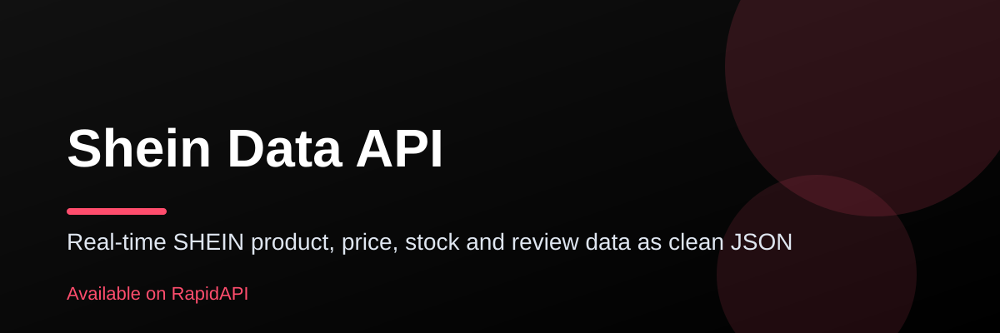

# Shein Data API

**Real-time SHEIN product, price, stock and review data as clean JSON**

Search SHEIN's catalog, pull full product details, live prices and stock per size, colors, size charts, ratings, reviews, customer photos, categories, trending keywords and store profiles, all through one REST API.

[**Try it on RapidAPI**](https://rapidapi.com/belchiorarkad-FqvHs2EDOtP/api/shein-data-api) · [Telegram support: @pintoflow](https://t.me/pintoflow)

## What you get

- Product search, category and store listings with filters and sorting
- Product details: price, stock per size, colors, size chart, ratings
- Reviews summary and customer photo gallery
- Full category tree, search suggestions, trending keywords and trends
- Store info, promotions and keywords
- Batch price endpoint (up to 10 products per call)
- Country selector (US, GB, FR, DE, BR, MX and more)

## Popular use cases

- Price and stock monitoring
- Dropshipping and catalog sync
- Fashion trend research
- Affiliate and comparison sites

## Quick start

1. Subscribe to the free BASIC plan on [RapidAPI](https://rapidapi.com/belchiorarkad-FqvHs2EDOtP/api/shein-data-api).
2. Copy your `X-RapidAPI-Key`.
3. Make your first request:

```bash
curl --request GET \
  --url 'https://shein-data-api.p.rapidapi.com/search/products?query=dress&country=US' \
  --header 'X-RapidAPI-Key: YOUR_RAPIDAPI_KEY' \
  --header 'X-RapidAPI-Host: shein-data-api.p.rapidapi.com'
```

## Plans

A free BASIC plan is available to test the API; paid plans raise limits. See the [pricing on RapidAPI](https://rapidapi.com/belchiorarkad-FqvHs2EDOtP/api/shein-data-api).

## Support

Questions, bugs or feature requests? Message us on Telegram: [@pintoflow](https://t.me/pintoflow).

[Get your API key on RapidAPI](https://rapidapi.com/belchiorarkad-FqvHs2EDOtP/api/shein-data-api)
